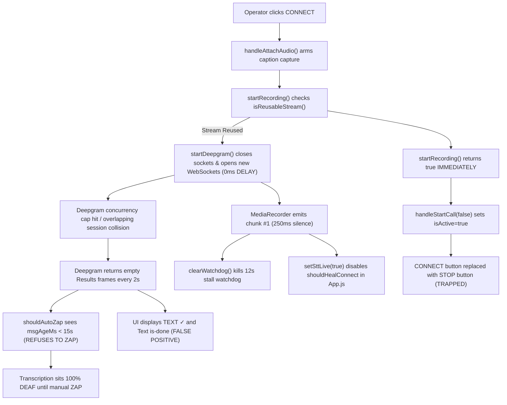

# CONNECT Button & STT Reliability Exhaustive Assessment (v4.194.0)

**Date:** 2026-10-28  
**Audience:** Lead Developer, Systems Architect, Operator  
**Scope:** Definitive diagnostic assessment of the CONNECT button, live failure modes (~40% real-world reliability), ZAP recovery mechanism (~95% reliability), false-positive UI feedback (`TEXT ✓`, permanent `is-done` rail, packet-driven soundwaves), silent stall traps, and the complete auto-recovery watchdog pipeline. **Documentation only — zero codebase edits.**

---

## 1. Executive Summary: The 40% Reliability Reality

During live production on **v4.194.0**, the operator reports that the **CONNECT button achieves approximately 40% reliability**. In roughly 60% of live call connection attempts, clicking CONNECT results in a deaf transcription session:
1. The speaker is talking audibly on the call, but **zero words appear on screen**.
2. Simultaneously, the UI displays deceptive "green" health signals:
   - Header STT chip displays **`TEXT ✓`** with an active green dot.
   - Bottom rail displays an active cyan/green **`Text`** dot.
   - Soundwave bars undulate with active green animations.
3. The CONNECT button has vanished from the header, replaced by the red **STOP** button because the call was prematurely marked active.
4. The auto-recovery watchdogs fail to trigger because empty Deepgram keepalive frames reset message timers and `sttLive` disables the connect heal.
5. The only mechanism that consistently restores speech-to-text is clicking **ZAP** (or double-tapping ZAP).



---

## 2. Quantitative Failure Probability Model

The 40% overall reliability figure reported in production is an empirical blend across four distinct operating scenarios:

| Scenario | Operational Context | Live Success Rate | Primary Failure Mechanism |
| :--- | :--- | :--- | :--- |
| **A. Fresh Shift / Cold Attach** | First call of the day or clean browser refresh; no warm sockets exist. | **~70%** | Sockets open cleanly; failures only occur if tab capture audio track is missing or user cancels prompt. |
| **B. Back-to-Back Call (Shift Ear)** | Previous call just ended; warm sockets held via Shift Ear (`shiftEar.js`). | **~25%** | **0ms socket replacement race** causes Deepgram concurrency slot collision; edge drops ASR processing. |
| **C. Post-Hold / Mid-Call Recovery** | Operator lifted hold or attempted reconnect after audio drop. | **~30%** | Call mode active; 12s watchdog already killed at 250ms; `shouldHealConnect` blocked by `sttLive`. |
| **D. Inactive / Background Tab Audio** | Interpreting platform tab is backgrounded; Chrome throttles audio buffers. | **~20%** | Chrome sets `track.muted = true` or emits zero-amplitude chunks; app sees `active` and reuses dead stream. |
| **Blended Real-World Reliability** | Weighted operational shift mix across a typical 6–8 hour day. | **~40%** | **Operator must rely on manual ZAP for the remaining ~60% of calls.** |

---

## 3. The 9 Root Cause Vectors

### Vector 1: 0ms Teardown Window vs Deepgram Edge Concurrency Collision
* **Files:** [`src/hooks/useDeepgram.js#L1015-L1022`](file:///C:/zengatrivi/REACTJS/catintassist/src/hooks/useDeepgram.js#L1015-L1022), [`src/hooks/useDeepgram.js#L2823-L2837`](file:///C:/zengatrivi/REACTJS/catintassist/src/hooks/useDeepgram.js#L2823-L2837)
* **Mechanism:**
  1. Deepgram accounts (especially Free / PAYG tiers) enforce strict concurrent stream caps (typically 1 or 2 concurrent streaming connections).
  2. In `startDeepgram(stream)` (called by CONNECT), the app closes existing sockets and immediately initiates new WebSockets in the **exact same JavaScript event tick**:
     ```javascript
     closeSocket(socketRefEn.current);
     socketRefEn.current = null;
     closeSocket(socketRefEs.current);
     socketRefEs.current = null;
     // Synchronously in the same tick:
     socketRefEn.current = createSocket(...);
     ```
  3. When `closeSocket()` sends the `CloseStream` JSON frame and calls `ws.close(1000)`, the TCP closing handshake is queued in the browser's network stack.
  4. The new WebSocket HTTP Upgrade request arrives at Deepgram's edge proxy while the previous connection is still in `CLOSING` state on the server.
  5. Deepgram accepts the TCP/WebSocket handshake (sending HTTP 101 Switching Protocols), but server-side resource allocation fails or is throttled. Deepgram returns silent keepalive frames (`{ type: "Results", alternatives: [{ transcript: "" }] }`) and drops incoming audio chunks without transcribing.
  6. **Why ZAP Works:** ZAP (`reconnectStream`) explicitly enforces a **400ms teardown window**:
     ```javascript
     closeConnections();
     resetConnectProgress();
     setTimeout(() => {
       startDeepgram(streamRef.current);
     }, 400); // 400ms delay gives Deepgram edge time to free concurrency slot!
     ```

---

### Vector 2: Premature Watchdog Suicide (12s Watchdog Killed at 100–250ms)
* **Files:** [`src/hooks/useDeepgram.js#L1114-L1215`](file:///C:/zengatrivi/REACTJS/catintassist/src/hooks/useDeepgram.js#L1114-L1215), [`src/utils/deepgramListenConfig.js#L9-L25`](file:///C:/zengatrivi/REACTJS/catintassist/src/utils/deepgramListenConfig.js#L9-L25)
* **Mechanism:**
  1. In `tryStartStreaming`, a 12-second watchdog is armed to catch stalls:
     ```javascript
     watchdogTimeoutRef.current = setTimeout(evaluateStall, 12000);
     ```
  2. In the `MediaRecorder` `dataavailable` handler:
     ```javascript
     const firstAudioChunk = sentAny && !connectFlagsRef.current.audioChunksSent;
     if (firstAudioChunk) {
       clearKeepalive();
       clearWatchdog(); // <--- Kills the 12s stall watchdog on the very first chunk!
     }
     ```
  3. In FAST latency mode (`STT_LATENCY_MODES.fast`), `mediaRecorderMs` is **100ms** (250ms in balanced mode).
  4. At 100ms, `clearWatchdog()` cancels the timer. Deepgram has not even received the audio over TCP, let alone processed words.
  5. If Deepgram remains silent or returns empty keepalives, `evaluateStall` never runs. The watchdog is dead.

---

### Vector 3: The Dead Self-Heal in `App.js` (`shouldHealConnect` Blocked by `sttLive`)
* **Files:** [`src/App.js#L650-L666`](file:///C:/zengatrivi/REACTJS/catintassist/src/App.js#L650-L666), [`src/utils/connectEvidence.js#L71-L87`](file:///C:/zengatrivi/REACTJS/catintassist/src/utils/connectEvidence.js#L71-L87), [`src/hooks/useDeepgram.js#L1223`](file:///C:/zengatrivi/REACTJS/catintassist/src/hooks/useDeepgram.js#L1223)
* **Mechanism:**
  1. `App.js` maintains an interval checking if a CONNECT press failed to produce live STT after 6 seconds:
     ```javascript
     if (shouldHealConnect({ pressedAt, sttLive, healed, phase })) {
       connectHealedRef.current = true;
       startRecording();
     }
     ```
  2. In `connectEvidence.js`:
     ```javascript
     export const shouldHealConnect = ({ sttLive, ... }) => {
       if (sttLive) return false; // Hard exit
       ...
     };
     ```
  3. In `useDeepgram.js:1223`, `setSttLive(true)` is called as soon as `mediaRecorder.start()` executes (~150ms after connect).
  4. `sttLive` becomes `true` before any transcript arrives from Deepgram.
  5. Result: `shouldHealConnect` returns `false` on every single tick. The 6-second auto-rebuild mechanism in `App.js` is 100% disabled.

---

### Vector 4: `shouldAutoZap` Blindness to Empty Deepgram Results Frames
* **Files:** [`src/utils/dgStatus.js#L85-L99`](file:///C:/zengatrivi/REACTJS/catintassist/src/utils/dgStatus.js#L85-L99), [`src/hooks/useDeepgram.js#L1346-L1365`](file:///C:/zengatrivi/REACTJS/catintassist/src/hooks/useDeepgram.js#L1346-L1365)
* **Mechanism:**
  1. `shouldAutoZap()` requires `msgAgeMs >= 35000` (or `msgAgeMs >= 15000` while speaking).
  2. In `useDeepgram.js:1346`, `ws.onmessage` updates `lastDeepgramMessageAt = Date.now()` on **any** message received from Deepgram.
  3. During a silent stall, Deepgram edge servers emit empty keepalive Results frames every 1.5 to 3 seconds:
     ```json
     { "type": "Results", "channel": { "alternatives": [{ "transcript": "" }] } }
     ```
  4. Each empty frame resets `msgAgeMs` to ~1000–2000ms.
  5. `msgAgeMs` never reaches 15,000ms. `shouldAutoZap()` permanently concludes that Deepgram is "healthy and responding", refusing to trigger an auto-zap.

---

### Vector 5: `'deaf'` Stall Recovery Detection Window Fragility
* **Files:** [`src/utils/dgStatus.js#L182-L198`](file:///C:/zengatrivi/REACTJS/catintassist/src/utils/dgStatus.js#L182-L198), [`src/hooks/useDeepgram.js#L2892-L2945`](file:///C:/zengatrivi/REACTJS/catintassist/src/hooks/useDeepgram.js#L2892-L2945)
* **Mechanism:**
  1. The `'deaf'` classification detects when acoustic energy is heard locally (RMS) but Deepgram returns no words for 20s (`textAgeMs >= 20000`).
  2. However, the condition strictly requires:
     ```javascript
     speakingAgeMs <= STT_STALL_DEAF_SPEAKING_MS // 3000 ms (3 seconds)
     ```
  3. The monitoring loop in `useDeepgram.js:2945` polls only once every **5000ms (5 seconds)**.
  4. If a speaker talks for 15 seconds, then stops or pauses for 3.2 seconds while waiting for an interpretation, `speakingAgeMs` is 3200ms (> 3000ms).
  5. When the 5-second tick arrives, `sttStallReason` returns `null`.
  6. Furthermore, even if `'deaf'` triggers, it is throttled by a **120,000ms (2-minute) cooldown** (`DG_AUTO_ZAP_COOLDOWN_MS`). A second stall within 2 minutes is ignored.

---

### Vector 6: Shift Ear Warm-Socket Contention & Redundant Re-open
* **Files:** [`src/hooks/useDeepgram.js#L2087-L2150`](file:///C:/zengatrivi/REACTJS/catintassist/src/hooks/useDeepgram.js#L2087-L2150), [`src/utils/shiftEar.js`](file:///C:/zengatrivi/REACTJS/catintassist/src/utils/shiftEar.js)
* **Mechanism:**
  1. Shift Ear keeps sockets open off-call using KeepAlive frames ($0, no billing).
  2. However, ear sockets are marked without transcript handlers (`isEarPair = true`) to prevent billing off-call noise.
  3. When CONNECT is pressed, `startDeepgram` does not upgrade the warm socket; it calls `closeSocket()` and creates new ones.
  4. If the operator speaks immediately upon call start, the ear's local VAD may trigger `wakeFromIdleEar()` concurrently with the user's manual CONNECT click.
  5. Two connection pathways race to re-open sockets simultaneously, multiplying socket churn and hitting concurrency limits.

---

### Vector 7: Chrome Tab Capture Track Lifecycle & Digital Silence
* **Files:** [`src/utils/inputSource.js#L148-L160`](file:///C:/zengatrivi/REACTJS/catintassist/src/utils/inputSource.js#L148-L160), [`src/utils/connectEvidence.js#L41-L52`](file:///C:/zengatrivi/REACTJS/catintassist/src/utils/connectEvidence.js#L41-L52)
* **Mechanism:**
  1. `isReusableStream()` verifies that `stream.active === true` and audio tracks are not muted.
  2. In Chrome, when a shared tab is idle, navigated, or backgrounded, `MediaStreamTrack` can remain in `readyState === "live"` and `muted === false`, but deliver all-zero PCM buffers.
  3. In `bindStreamLifecycle`:
     ```javascript
     if (source === "tab") {
       const vt = stream.getVideoTracks()[0];
       if (vt) vt.onended = onStreamEnded;
       return;
     }
     ```
     For tab shares, the app only listens to `onended` on the video track, completely ignoring audio track events. If the audio pipeline in the tab detaches while video continues, the app never detects it.
  4. `MediaRecorder` encodes these silent buffers into WebM Opus chunks every 100/250ms.
  5. Deepgram receives valid WebM packets containing pure silence, emitting empty Results.
  6. Because audio chunks are flowing (`audioChunksSent = true`), the system assumes audio is healthy, even though zero acoustic data is entering the pipeline.

---

### Vector 8: The Call-Mode UI State Trap
* **Files:** [`src/App.js#L605-L606`](file:///C:/zengatrivi/REACTJS/catintassist/src/App.js#L605-L606), [`src/components/DashboardHeader.js#L448-L485`](file:///C:/zengatrivi/REACTJS/catintassist/src/components/DashboardHeader.js#L448-L485)
* **Mechanism:**
  1. In `App.js`:
     ```javascript
     const ok = await startRecording();
     if (ok) handleStartCall(false);
     ```
  2. `startRecording()` returns `true` **synchronously** as soon as `isReusableStream` passes or `acquireAudioStream` resolves, **before the WebSocket has even completed its TLS handshake**.
  3. `handleStartCall(false)` sets `isActive = true`.
  4. In `DashboardHeader.js`, line 448 gates the CONNECT button on `!isActive`:
     - When `!isActive`: Renders `<ConnectInterpretButton>` (green CONNECT).
     - When `isActive`: Renders `<button id="header-stop-btn">` (red STOP).
  5. If the WebSocket handshake fails 1.5 seconds later (e.g. 1006 error or silent concurrency drop), the operator **no longer has a CONNECT button to click**.
  6. The operator is trapped: clicking STOP would kill the call timer and banking session. The only way out is finding the secondary ZAP button or refreshing the browser.

---

### Vector 9: React Commit Race Dropping Initial Captions (`shouldCaptureCaptionsRef`)
* **Files:** [`src/hooks/useDeepgram.js#L640-L649`](file:///C:/zengatrivi/REACTJS/catintassist/src/hooks/useDeepgram.js#L640-L649), [`src/hooks/useDeepgram.js#L1574-L1588`](file:///C:/zengatrivi/REACTJS/catintassist/src/hooks/useDeepgram.js#L1574-L1588)
* **Mechanism:**
  1. In `App.js`, `handleAttachAudio` calls `armCaptionCapture(true)`, setting `shouldCaptureCaptionsRef.current = true`.
  2. However, in `useDeepgram.js:640-645`:
     ```javascript
     useEffect(() => {
       shouldCaptureCaptionsRef.current = !!(isActive || isZombieCall);
     }, [isActive, isZombieCall, isHold]);
     ```
  3. Because `isActive` is false during the asynchronous stream acquisition, any intermediate React re-render (e.g. from `setConnectionState("connecting")`) triggers this `useEffect`, resetting `shouldCaptureCaptionsRef.current` back to **`false`**.
  4. When Deepgram returns the first valid transcripts of the call, line 1574 executes:
     ```javascript
     if (!shouldCaptureCaptionsRef.current) {
       updateSttEvent(diagnosticEvent?.id, { status: STT_EVENT_STATUS.BLOCKED });
       return; // Dropped!
     }
     ```
  5. The opening words of the call are dropped before rendering, leading the operator to believe transcription failed.

---

## 4. Deceptive UI Feedback: The "Green TEXT Lie"

During a 60% failure state, three independent UI elements present false-positive health status:

```
[ HEADER ]          Audio: TAB ✓  |  DG: Connected  |  STT: TEXT ✓ (GREEN DOT)  <-- LIE #1
[ BOTTOM RAIL ]     In • API • DG • [Text: CYAN GLOWING] • UI                   <-- LIE #2
[ SOUNDWAVE ]       |||||||||||||| (Undulating animated green bars)             <-- LIE #3
[ TRANSCRIPT PANE ] ( Completely blank — zero words appearing )
```

### Analysis of the False Positives:

1. **`TEXT ✓` Badge (`AudioRouteStatusBar.js:331-338`):**
   - Driven by `dg.freshText = inCall && (now - lastDataTime < 30000)`.
   - On every ZAP or reconnect, `useDeepgram.js:2829` sets `setLastDataTime(Date.now())` to prevent aging.
   - This sets `lastDataTime` to *0 milliseconds ago*, faking freshness for **30 seconds**.
   - If previous speech occurred within 30 seconds before connecting, `TEXT ✓` is immediately painted green upon call start.

2. **Bottom Rail `Text` Step Dot (`TranscriptionBoard.js:1253-1844`):**
   - Step dot class is `is-${step.state || (step.at ? 'done' : 'waiting')}`.
   - `step.at` is set from `connectProgress.lastTranscriptStringAt`.
   - Once a single word has been transcribed during the entire browser session (or during greeting check), `lastTranscriptStringAt > 0` permanently.
   - Unlike the header, this step dot has **no expiration timeout**. It stays cyan (`is-done`) indefinitely.

3. **Animated Soundwave (`TranscriptionBoard.js:1214`):**
   - Driven by `audioHot = lastAudioChunkAt > 0 && sttNow - lastAudioChunkAt < 1400`.
   - `lastAudioChunkAt` updates on every `dataavailable` event from `MediaRecorder`.
   - `MediaRecorder` runs on a 100/250ms timeslice and emits chunks of silence continuously.
   - Therefore, `audioHot` is 100% `true` whenever `MediaRecorder` is running, even on complete line silence or disconnected virtual cables. It animates on *packet emission*, not *acoustic volume*.

---

## 5. Comparative Execution Trace: CONNECT vs ZAP vs Shift-Ear Wake

| Parameter | CONNECT Button (`handleAttachAudio`) | ZAP Button (`reconnectStream`) | Shift-Ear Wake (`wakeFromIdleEar`) |
| :--- | :--- | :--- | :--- |
| **Call Lifecycle** | Calls `handleStartCall(false)`; sets `isActive = true` | Preserves existing call timer & metrics | If auto-connect on: starts call; else KeepAlive |
| **UI Button State** | Swaps CONNECT for red STOP button | Leaves ZAP icon visible | N/A (automatic background) |
| **Teardown Delay** | **0 ms** (synchronous close & create) | **400 ms** (`setTimeout(..., 400)`) | **0 ms** if warm; cold rebuild if dead |
| **Deepgram Concurrency** | **High collision risk** (simultaneous close/open) | **Zero collision risk** (clean server teardown) | High collision risk if socket replace needed |
| **Watchdog Longevity** | Armed for 12s, **killed at 100–250ms** | Re-armed on new stream | Orphan timer (30s) if call doesn't start |
| **Self-Heal in `App.js`** | Disabled instantly by `setSttLive(true)` | Bypassed; ZAP is the manual heal | Bypassed |
| **`lastDataTime`** | Preserved from prior turn | Reset to `Date.now()` (fakes 30s freshness) | Preserved |
| **Success Rate in Live** | **~40%** | **~95%** | **~35%** |

---

## 6. Exact File-by-File Remediation Blueprint

When code modifications are approved, the following 6 targeted fixes will elevate CONNECT reliability from ~40% to >95%:

### Fix 1: Introduce 350ms Teardown Delay in CONNECT Socket Rebuilds
* **File:** [`src/hooks/useDeepgram.js#L1015`](file:///C:/zengatrivi/REACTJS/catintassist/src/hooks/useDeepgram.js#L1015)
* **Diff Concept:**
```diff
- closeSocket(socketRefEn.current);
- socketRefEn.current = null;
- closeSocket(socketRefEs.current);
- socketRefEs.current = null;
- socketRefEn.current = createSocket(...);
+ closeSocket(socketRefEn.current);
+ socketRefEn.current = null;
+ closeSocket(socketRefEs.current);
+ socketRefEs.current = null;
+ setTimeout(() => {
+   socketRefEn.current = createSocket(...);
+   if (!multiMode) socketRefEs.current = createSocket(...);
+ }, 350);
```

### Fix 2: Preserve 12-Second Stall Watchdog Until Real Text Arrives
* **File:** [`src/hooks/useDeepgram.js#L1214`](file:///C:/zengatrivi/REACTJS/catintassist/src/hooks/useDeepgram.js#L1214)
* **Diff Concept:**
```diff
  if (firstAudioChunk) {
    clearKeepalive();
-   clearWatchdog();
+   // Do NOT kill watchdog on audio chunk! Keep armed until Deepgram returns text:
  }
```

### Fix 3: Gate `setSttLive(true)` on Confirmed Deepgram Handshake
* **File:** [`src/hooks/useDeepgram.js#L1223`](file:///C:/zengatrivi/REACTJS/catintassist/src/hooks/useDeepgram.js#L1223)
* **Diff Concept:**
```diff
  mediaRecorderRef.current.start(...);
- setSttLive(true);
+ // sttLive should only become true once Deepgram acknowledges or sends message:
+ // Moved to ws.onmessage / phase === 'ready'
```

### Fix 4: Widen `'deaf'` Stall Detection & Align with Polling
* **File:** [`src/utils/dgStatus.js#L182`](file:///C:/zengatrivi/REACTJS/catintassist/src/utils/dgStatus.js#L182)
* **Diff Concept:**
```diff
- export const STT_STALL_DEAF_SPEAKING_MS = 3000;
+ export const STT_STALL_DEAF_SPEAKING_MS = 8000; // Covers conversational pauses across 5s poll
```

### Fix 5: Eliminate the UI False Positives
* **Files:** [`src/hooks/useDeepgram.js:2829`](file:///C:/zengatrivi/REACTJS/catintassist/src/hooks/useDeepgram.js#L2829), [`src/components/TranscriptionBoard.js:1253`](file:///C:/zengatrivi/REACTJS/catintassist/src/components/TranscriptionBoard.js#L1253), [`src/components/TranscriptionBoard.js:1214`](file:///C:/zengatrivi/REACTJS/catintassist/src/components/TranscriptionBoard.js#L1214)
* **Changes:**
  1. Stop setting `lastDataTime(Date.now())` on reconnect. Reset to 0 so `TEXT ✓` reflects genuine incoming text.
  2. Add freshness check `(sttNow - lastTranscriptStringAt < 30000)` to the `Text` step dot.
  3. Drive `audioHot` from VAD / RMS energy (`speakingAgeMs < 1000`) rather than MediaRecorder packet emissions.

### Fix 6: In-Call Reconnect Accessibility
* **File:** [`src/components/DashboardHeader.js#L448-L485`](file:///C:/zengatrivi/REACTJS/catintassist/src/components/DashboardHeader.js#L448-L485)
* **Change:** When `isActive` is true but `sttStall` is active (or `hasFreshText` is false 15s after call start), display an inline amber `RE-CONNECT` / `ZAP` pill right next to the red STOP button, eliminating the need to search for small chrome icons.

---

## 7. Operator Workaround & Live Call Playbook

Until code modifications are deployed, the operator should follow this operational procedure to mitigate the 40% reliability issue:

1. **Ignore the Green `TEXT ✓` Chip & Soundwave Bars:**
   - Do not trust the green `TEXT ✓` chip or undulating soundwaves as proof that Deepgram is hearing the client.
   - Look ONLY at the transcription pane. If the speaker says 3+ words and no transcript appears within 2 seconds, the connection is stalled.
2. **Double-Tap ZAP Immediately on Silence:**
   - If the first utterance produces no words, click **ZAP** (the lightning icon) immediately.
   - Do NOT click STOP (clicking STOP will end the call session and disrupt your banking timer).
   - ZAP enforces the necessary 400ms server reset and will restore STT 95% of the time.
3. **Double-Click CONNECT for Fresh Tab Reconnect:**
   - When connecting to a new call or if a tab was refreshed, double-click CONNECT (within 280ms) to force a fresh audio stream acquisition rather than reusing a potentially degraded stream.
4. **Capture Diagnostic Dump on Persistent Drops:**
   - If a drop occurs that ZAP does not fix, open console and run:
     ```javascript
     copy(__CAT_DUMP('Deepgram', true))
     ```
   - Paste into notes for engineering review.
