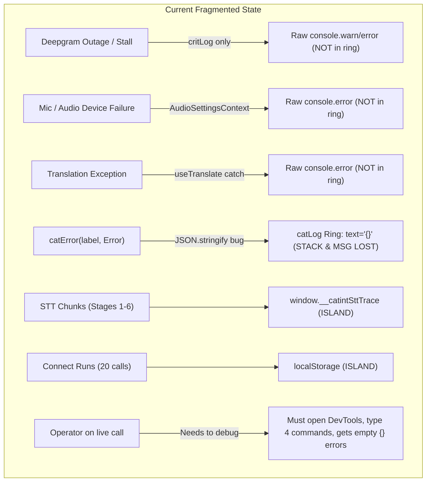
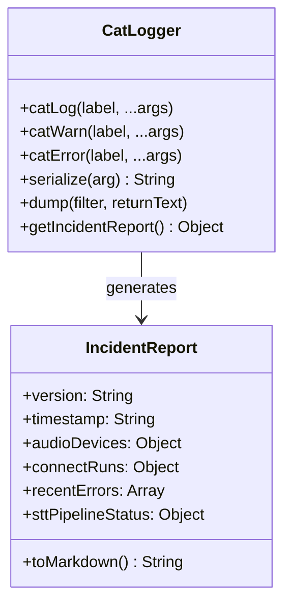

# Console Logs & Error Tracing Architecture Assessment (v4.198.0)

**Date:** 2026-10-28  
**Scope:** Complete diagnostic assessment of client-side console logging, error tracing, circular ring capture, and debugging ergonomics for critical transcription, connection, and audio failures.  
**Objective:** Eliminate debugging friction during live calls so that capturing critical incidents requires zero cognitive overhead.

---

## 1. Executive Summary

Debugging critical failures during live calls in **v4.198.0** is hindered by six structural flaws in logging and error handling:

1. **Error Object Erasure:** `catLog.js` uses `JSON.stringify(arg)`, which converts native JavaScript `Error`, `DOMException`, and `Event` objects into `{}` (empty objects). Stack traces and error messages are wiped clean from the ring buffer.
2. **Two-Logger Fracture:** `critLog` in [`src/hooks/useDeepgram.js`](file:///C:/zengatrivi/REACTJS/catintassist/src/hooks/useDeepgram.js) bypasses `catLog` entirely, calling raw `console[level]` with a 5-second gate. Its critical connection messages are completely missing from `__CAT_DUMP()`.
3. **40+ Raw Console Calls Bypassing Ring:** Hardware audio errors (mic permission denied, device enumeration failed, sink routing failure), translation catch blocks, and React crashes in [`ErrorBoundary.js`](file:///C:/zengatrivi/REACTJS/catintassist/src/components/ErrorBoundary.js) bypass the circular ring buffer.
4. **Isolated Diagnostic Islands:** Diagnostic data is fragmented across five unconnected locations: `catLog.ring`, `window.__catintSttTrace`, `window.__CAT_CONNECTS()` (`localStorage`), `sessionStorage[catint_last_connect_v1]`, and `window.__CAT_ROUTE_DIAG`.
5. **No Global Unhandled Error Capture:** Asynchronous promise rejections and WebSocket uncaught exceptions are not intercepted by any top-level handler.
6. **Cumbersome Live Ergonomics:** The operator cannot open DevTools (F12) while interpreting on call. There is no one-tap UI mechanism to export an incident report.



```mermaid
flowchart TD
    subgraph Target Unified Architecture
        U1["All Errors, Stalls & Route Events"] --> U2["catLog / catWarn / catError (Single Logger)"]
        U2 -->|Safe Serializer (name, msg, stack, cause)| U3["Unified In-Memory Ring Buffer"]
        U4["window.onerror & unhandledrejection"] --> U2
        U3 --> U5["window.__CAT_INCIDENT()"]
        U6["One-Tap UI Button (Red Banner & Settings)"] -->|1 Click| U7["Clipboard: Markdown Incident Report Ready to Paste"]
    end
```

---

## 2. Complete Inventory of Logging Call Sites

An audit of the codebase reveals **60 `console.*` call sites**, of which **40 are non-test production calls bypassing `catLog`**:

| Component / Module | Raw `console.*` Count | Current Behavior & Content | Risk / Flaw |
| :--- | :---: | :--- | :--- |
| [`src/hooks/useDeepgram.js`](file:///C:/zengatrivi/REACTJS/catintassist/src/hooks/useDeepgram.js) | **8** | `critLog` calls `console[level]`; 3 bare `console.error(err)` calls; `console.warn("Failed to stop recorder")`; `console.warn("[captionEngine slow]")` | Critical STT fail & deaf heals bypass `__CAT_DUMP()`. Bare errors dump without labels. |
| [`src/contexts/AudioSettingsContext.js`](file:///C:/zengatrivi/REACTJS/catintassist/src/contexts/AudioSettingsContext.js) | **7** | Mic permission denied, device enumerate fail, setSinkId fail, physical mic capture fail, playClipToSink fail, mic monitor fail | Zero audio hardware failures enter the ring. If mic dies, dump shows nothing. |
| [`src/components/GreetingsPanel.js`](file:///C:/zengatrivi/REACTJS/catintassist/src/components/GreetingsPanel.js) | **9** | Storage summary fail, 4 bare `console.error(e)`, waveform decode fail, health check fail, mic id retry, playback error | Bare errors, greeting playback failures invisible to diagnostics. |
| [`src/hooks/useTTS.js`](file:///C:/zengatrivi/REACTJS/catintassist/src/hooks/useTTS.js) | **3** | Browser synthesis fallback info, local play error, sink play error | Audio sink playback errors bypass ring. |
| [`src/contexts/AuthContext.js`](file:///C:/zengatrivi/REACTJS/catintassist/src/contexts/AuthContext.js) | **3** | Cloud push fail, time-track pull fail, cloud pull fail | Cloud sync issues bypass ring. |
| [`src/components/OnCallSoundboardStrip.js`](file:///C:/zengatrivi/REACTJS/catintassist/src/components/OnCallSoundboardStrip.js) | **2** | Local sound play error, remote play error | Soundboard failures bypass ring. |
| [`src/components/ErrorBoundary.js`](file:///C:/zengatrivi/REACTJS/catintassist/src/components/ErrorBoundary.js) | **1** | `console.error('[ErrorBoundary]', error, info?.componentStack)` | React crashes bypass ring; dump lacks UI crash stack. |
| [`src/hooks/useTranslate.js`](file:///C:/zengatrivi/REACTJS/catintassist/src/hooks/useTranslate.js) | **1** | `console.error('[Trans] Catch:', e)` | Translation engine exceptions bypass ring. |
| [`src/components/GreetingEditorView.js`](file:///C:/zengatrivi/REACTJS/catintassist/src/components/GreetingEditorView.js) | **1** | `console.error('Preview play failed:', e)` | Audio preview fail bypasses ring. |
| [`src/hooks/useGreetingClip.js`](file:///C:/zengatrivi/REACTJS/catintassist/src/hooks/useGreetingClip.js) | **1** | `console.warn('Health check failed:', e)` | Clip health check bypasses ring. |
| Audio Routing (`audioRoute.js`, `audioRoutePassthrough.js`, `routeDiagnostics.js`) | **4** | Route bind failure, passthrough play warning, debug logs | Audio sink binding failures bypass ring. |
| [`src/utils/catLog.js`](file:///C:/zengatrivi/REACTJS/catintassist/src/utils/catLog.js) | **4** | Internal logger emit (`console.error`, `console.warn`, verbose `console.log`, `dump()`) | Intentional logging engine emitters. |
| Test Suites (`*.test.js`) | **16** | Unit test mocks and debug assertions | Benign test code. |

---

## 3. The 6 Root Cause Vectors

### Vector 1: The Error Serialization Bug (`JSON.stringify` Wipes Errors)
* **File:** [`src/utils/catLog.js#L29-L40`](file:///C:/zengatrivi/REACTJS/catintassist/src/utils/catLog.js#L29-L40)
* **Mechanism:**
  ```javascript
  function serialize(args) {
    return args
      .map((a) => {
        if (typeof a === 'string') return a;
        try {
          return JSON.stringify(a);
        } catch {
          return String(a);
        }
      })
      .join(' ');
  }
  ```
* **Failure Mode:** In JavaScript, `Error.prototype.message`, `name`, and `stack` are **non-enumerable**. `JSON.stringify(new Error("socket timeout"))` returns `{}`. When someone logs `catError("[Storage:save] Failed", err)`, the stored ring entry is:
  `21:04:12 ERROR [Storage:save] Failed {}`
* **Real-World Impact:** All error messages, HTTP status codes, and call stacks are erased from the log ring.

### Vector 2: Two-Logger Fracture (`critLog` vs `catLog`)
* **File:** [`src/hooks/useDeepgram.js#L426-L443`](file:///C:/zengatrivi/REACTJS/catintassist/src/hooks/useDeepgram.js#L426-L443)
* **Mechanism:**
  `useDeepgram.js` defines its own hook-local `critLog` function that emits directly to `console[level](`[CAT STT CRIT] ${message}`, extra)`. It does not call `catLog`, `catWarn`, or `catError`.
* **Real-World Impact:**
  `critLog` handles the most vital connection diagnostics:
  - Audio track muted / disabled alerts
  - WebSocket error & failConnection reports
  - Auto-reconnect stream triggers (deaf heal 10s+, silent 15s+)
  - MediaRecorder 10s audio chunk rebuilds
  Because `critLog` bypasses `catLog`, running `__CAT_DUMP()` after a connection drops produces **zero of these critical breadcrumbs**.

### Vector 3: STT Pipeline Stage Disconnect (Stages 1–6 vs Stage 7)
* **Files:** [`src/hooks/useDeepgram.js#L445-L459`](file:///C:/zengatrivi/REACTJS/catintassist/src/hooks/useDeepgram.js#L445-L459), [`src/components/TranscriptionBoard.js#L1030-L1046`](file:///C:/zengatrivi/REACTJS/catintassist/src/components/TranscriptionBoard.js#L1030-L1046)
* **Mechanism:**
  - Stages 1–6 (audio chunk received, audio sent to websocket, DG message received, processed empty, string returned, engine committed) are pushed to `window.__catintSttTrace`.
  - Stage 7 (string rendered on board) is logged to `catLog`.
* **Real-World Impact:**
  If transcription stops, looking at `catLog` only tells you that Stage 7 stopped rendering. You cannot tell whether:
  - Stage 1 stopped (mic/tab stopped sending chunks),
  - Stage 2 stopped (socket buffer choked), or
  - Stage 3/4 stopped (Deepgram went silent or returned empty frames).
  The operator must inspect two completely different data structures.

### Vector 4: Island Diagnostic Stores
* **Components:**
  1. `catLog.ring` (`src/utils/catLog.js`)
  2. `window.__catintSttTrace` (`src/hooks/useDeepgram.js`)
  3. `localStorage['catint_connect_runs_v1']` (`src/utils/connectRuns.js` via `__CAT_CONNECTS()`)
  4. `sessionStorage['catint_last_connect_v1']` (`src/utils/connectEvidence.js`)
  5. `window.__CAT_ROUTE_DIAG` (`src/utils/routeDiagnostics.js`)
* **Real-World Impact:**
  No single function provides a cohesive view of an incident. Debugging requires juggling multiple window globals and storage keys.

### Vector 5: Missing Global Unhandled Error Interception
* **Files:** Entire application entry tree (`src/index.js`, `src/App.js`).
* **Mechanism:**
  While [`src/components/ErrorBoundary.js`](file:///C:/zengatrivi/REACTJS/catintassist/src/components/ErrorBoundary.js) catches React lifecycle render crashes, asynchronous errors (e.g. unhandled promise rejections inside Web Worker messages, MediaRecorder callbacks, WebSocket listeners, IndexedDB transactions) are completely unhandled.
* **Real-World Impact:**
  Async failures disappear into the browser console without entering the ring buffer.

### Vector 6: Operational Friction for On-Call Interpreters
* **Context:** The operator uses the app while actively interpreting high-stakes bilingual calls (900×600 viewport, narrow cognitive bandwidth).
* **Failure Mode:**
  When transcription stalls or drops:
  - Opening Chrome DevTools covers half the screen and steals focus.
  - Remembering console syntax (`copy(__CAT_DUMP('Deepgram', true))`) is impossible under pressure.
  - There is no 1-tap clipboard button on the red reconnect banner.

---

## 4. Proposed Solution Architecture: The Unified Diagnostic Standard



### 1. Robust Serializer in `src/utils/catLog.js`
Replace naive `JSON.stringify` with an error-aware serializer:
```javascript
export function serializeArg(a) {
  if (a == null) return String(a);
  if (typeof a === 'string') return a;
  if (a instanceof Error || (typeof a === 'object' && 'message' in a && 'stack' in a)) {
    return `${a.name || 'Error'}: ${a.message}${a.stack ? `\n${a.stack}` : ''}${a.cause ? `\nCaused by: ${serializeArg(a.cause)}` : ''}`;
  }
  if (typeof DOMException !== 'undefined' && a instanceof DOMException) {
    return `DOMException (${a.name}): ${a.message}`;
  }
  if (typeof Event !== 'undefined' && a instanceof Event) {
    return `Event (${a.type}): target=${a.target?.constructor?.name || 'unknown'}`;
  }
  try {
    return JSON.stringify(a, (key, value) => {
      if (value instanceof Error) {
        return { name: value.name, message: value.message, stack: value.stack };
      }
      return value;
    });
  } catch {
    return String(a);
  }
}
```

### 2. Unify `critLog` into `catLog`
Eliminate hook-local `critLog` in `src/hooks/useDeepgram.js`. Replace with standard `catWarn` / `catError` with standard labels:
- `catWarn('[STT:stall]', message, extra)`
- `catError('[STT:fail]', message, extra)`
- `catWarn('[STT:audio-mute]', ...)`
- `catWarn('[STT:deaf-heal]', ...)`

### 3. Route All Raw `console.*` Calls Through `catLog`
- `AudioSettingsContext.js`: Replace all 7 raw calls with `catWarn('[Audio:perm]', e)`, `catError('[Audio:device]', err)`, etc.
- `useTranslate.js`: Replace `console.error('[Trans] Catch:', e)` with `catError('[Translate:fail]', e)`.
- `ErrorBoundary.js`: Call `catError('[UI:crash]', error, { componentStack: info?.componentStack })`.
- `GreetingsPanel.js` & `useTTS.js`: Replace raw calls with `catWarn`/`catError`.

### 4. Install Global Handlers in `src/index.js` / `catLog.js`
```javascript
if (typeof window !== 'undefined') {
  window.addEventListener('error', (event) => {
    catError('[Global:uncaught]', event.error || event.message);
  });
  window.addEventListener('unhandledrejection', (event) => {
    catError('[Global:unhandled-rejection]', event.reason);
  });
}
```

### 5. Unified `__CAT_INCIDENT()` Command
Create `window.__CAT_INCIDENT(returnText = false)` that automatically compiles:
1. **Header:** `APP_VERSION`, current time, viewport dimensions (`window.innerWidth x innerHeight`), user agent.
2. **Audio Hardware State:** Source mode (tab/mic), track readyState, muted, volume level.
3. **STT Connection State:** Live status, active socket language, connect runs summary (`window.__CAT_CONNECTS()`), last close code.
4. **Pipeline Stage Summary:** Last timestamps of stages 1 to 7 from `__catintSttTrace`.
5. **Errors & Warnings:** All warn/error entries from `ring` (deduped, newest last, with full stacks).
6. **Auto-Copy to Clipboard:** Automatically invokes `navigator.clipboard.writeText()` so typing `__CAT_INCIDENT()` copies immediately without needing `copy(...)`.

### 6. One-Tap UI Incident Button
- In the red reconnect banner (`src/components/TranscriptionBoard.js` / `App.js`):
  Add a compact `📋 Copy Log` button next to `Reconnecting...`.
- In Settings → App / Info tab:
  Add an `Export Diagnostic Log` button that calls `__CAT_INCIDENT()`.

---

## 5. Phased Implementation Plan

| Phase | Scope | Target Files | Verification Gate |
| :---: | :--- | :--- | :--- |
| **Phase 1** | Safe Error Serializer + Global Handlers + `__CAT_INCIDENT()` | `src/utils/catLog.js`, `src/utils/catLog.test.js` | Unit tests verify `new Error()` stack & message serialization, repeat collapsing, and markdown generation. |
| **Phase 2** | Eliminate `critLog` & Unify `useDeepgram.js` | `src/hooks/useDeepgram.js` | STT stalls, deaf heals, and socket errors appear in `__CAT_DUMP()`. Tests in `useDeepgram.connect.test.js` green. |
| **Phase 3** | Migrate Audio, Translate & UI Boundaries | `AudioSettingsContext.js`, `useTranslate.js`, `ErrorBoundary.js`, `GreetingsPanel.js` | Audio permission and translation errors show in ring. Zero raw `console.*` in core pipelines. |
| **Phase 4** | One-Tap UI Export Button | Red stall banner & Settings view | Operator can copy complete diagnostic bundle to clipboard with 1 click during stall. |

---

## 6. Open Decisions for Operator

1. **Clipboard Permissions:** Should the UI button copy directly to clipboard (`navigator.clipboard.writeText`) with a brief "Copied ✓" toast, or open a modal preview? *(Recommended: Direct copy — zero obstruction on live call).*
2. **Verbose STT Chunks:** Should stage 1 & 2 audio chunks remain strictly opt-in (`catint_log_verbose`) to conserve memory, keeping only the last 20 stage transitions in `__CAT_INCIDENT()`? *(Recommended: Keep chunks opt-in; keep stage summary in incident report).*
