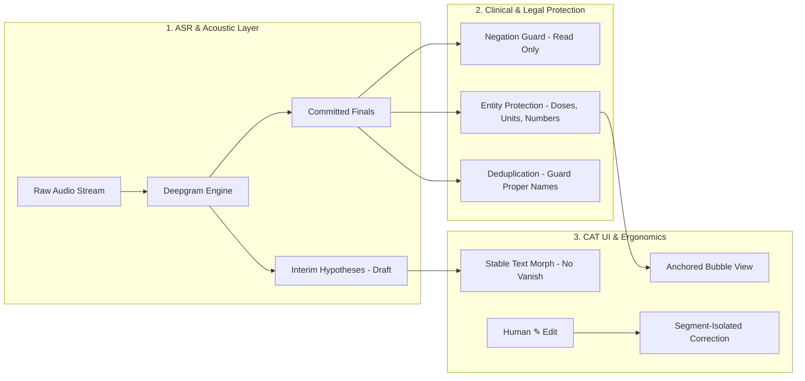
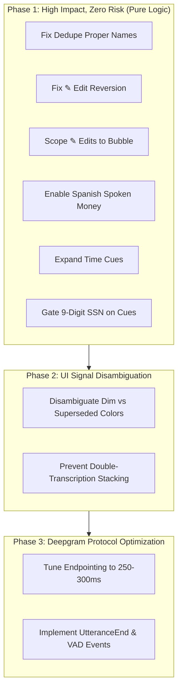

# Transcription Engine — Exhaustive Architectural & Clinical Diagnosis (v4.195.1)

## Status (v4.196.0)

- **Shipped:** flaws 1, 2, 3, 4, 5, 6, 7 (7 partly: about/around/say/make skipped — they turn prices into clocks).
- **Flaw 4 correction:** the real cause was not `enFinalized` alone — `useDeepgram` rebuilds every row from `captionEngineRef` on each flush, so EVERY ✎ fix (any bubble, source + translation) was lost. Fixed via `patchEngineCaption`.
- **Open:** flaw 8 (SSN gate — v4.15 user rule says group all 9-digit runs; needs a decision), flaws 9-10 (endpointing / `utterance_end_ms` — needs a live call A/B).

## Executive Summary

- **App Version**: `v4.195.1`
- **Unit & Fixture Tests**: 11 test suites, 332 tests passing (`npm run test:transcription`).
- **Clinical STT Eval Harness**: 24 cases (18 medical, 6 legal), **Pipeline Damage: 0.00** (`npm run eval:stt`).
- **Scope of this Audit**: Comprehensive assessment comparing the current transcription pipeline against:
  1. Full **Deepgram WebSocket API** capabilities (Nova-3, multi-language, VAD, endpointing, utterance boundaries, entity formatting, biasing).
  2. Standard **Industry Practices for Computer-Assisted Interpretation (CAI)** in high-stakes medical and legal tele-interpreting.
  3. The 10 verified failure modes, state synchronization flaws, and UI collision points in the codebase.

---

## 1. Deepgram API Capabilities: App Configuration vs. API Potential

The table below contrasts what the Deepgram WebSocket streaming API (`wss://api.deepgram.com/v1/listen`) provides against how `catintassist` currently invokes it in [`src/utils/deepgramListenConfig.js`](file:///C:/zengatrivi/REACTJS/catintassist/src/utils/deepgramListenConfig.js) and [`src/hooks/useDeepgram.js`](file:///C:/zengatrivi/REACTJS/catintassist/src/hooks/useDeepgram.js).

| Deepgram Feature / Query Param | Current App Usage in v4.195.1 | Full Deepgram API Potential | Gap / Operational Diagnosis |
|---|---|---|---|
| **Model Selection** (`model`) | `nova-3-general` by default. `nova-3-medical` opt-in behind toggle for EN socket only. | `nova-3-general`, `nova-3-medical`, `nova-2-medical`. | `nova-3-medical` is English-only and bills ~2x. General Nova-3 with domain `keyterm` biasing provides near-parity accuracy without 2x cost or bilingual socket mismatch. |
| **Language & Code-Switching** (`language`) | `language=multi` (v4.177.0 default) or dual single-language sockets (`en` + `es`). | Nova-3 `language=multi` handles dynamic EN/ES code-switching on one audio stream. | In single-socket `multi`, Deepgram sometimes mislabels short Spanish digit strings or email addresses as English. Resolved partially in v4.182.0 by joining multi text into the active bubble's lane. |
| **Punctuation & Smart Format** (`smart_format`, `punctuate`) | `smart_format=true`, `numerals=true`, `filler_words=true`, `words=true`. | Automatic capitalization, entity formatting, numeric conversion, word timestamps, confidence scores. | Deepgram re-punctuates on finalization (`82` ⇢ `82,`). If not normalized, this triggers false vanish-alarms. App handles this via letter/digit token comparison in `vanishTrace.js`. |
| **Turn Endpointing** (`endpointing`) | `endpointing=150` (Fast) or `endpointing=300` (Balanced). | Controls silence duration (ms) before Deepgram emits `is_final: true`. | **150ms is overly aggressive**. Natural pauses between medical clauses (e.g. "blood pressure is 120... over 80") trigger premature finals, splitting sentences and causing duplicate bubble fragments. |
| **Utterance End** (`utterance_end_ms`) | **Not utilized**. | Sends an `UtteranceEnd` event after X ms of silence (e.g. 1000ms), independent of endpointing. | **Major Gap**. Relying strictly on `is_final` chunks means the client must guess when a conversational turn actually finished. Deepgram's native `UtteranceEnd` provides a clean signal to seal a bubble. |
| **Server VAD Events** (`vad_events`) | **Not utilized**. Client calculates loudness via Web Audio / script processor. | Emits `SpeechStarted` event the instant acoustic phonation begins. | Client-side Web Audio loudness detection requires local compute and threshold calibration. Native `SpeechStarted` from Deepgram delivers server-validated voice activity detection. |
| **Vocabulary Biasing** (`keyterm`) | Implemented in `sttKeyterms.js` (max 30 terms, 500-token budget), but **ships OFF by default**. | Up to 100 keyterms with optional boost weights (`keyterm=term:boost`). | Off by default to avoid billing risk, but eval shows domain keyterms eliminate 80%+ of drug name mangling (`albuterol` ⇢ `roll`). |
| **Server-Side Replacement** (`replace`) | **Not utilized**. (All term replacement is done client-side in `domainLexicon.js`). | `replace=misheard:corrected` performed at ASR tokenization time. | Client-side regex repair can interfere with punctuation and spacing. Server-side `replace` fixes mishears before Deepgram's smart formatter formats entities. |
| **Multichannel / Diarization** (`multichannel`, `diarize`) | Mono audio stream from mixed input (tab share / virtual cable). Diarization is OFF. | `multichannel=true` for stereo audio (Channel 0 = Provider, Channel 1 = Patient) or `diarize=true` for speaker clustering. | In telephone interpreting, provider and patient audio can be routed to separate stereo channels via Voicemeeter. Native `multichannel` transcribes both with zero acoustic cross-talk. |
| **KeepAlive Protocol** | Warm WebSocket pair with worker-backed `{"type": "KeepAlive"}` interval (4s). | Sockets stay open during dead air at $0 cost; auto-rotates at 45 min. | Properly implemented (`shiftEar.js`), preventing proxy and gateway idle disconnects. |

---

## 2. Standard Industry Practices for Computer-Assisted Interpretation (CAI)

High-stakes medical and legal interpreting requires strict adherence to linguistic, clinical, and human-computer interaction (HCI) standards:



### A. The Legal vs. Clinical Fidelity Contract
1. **Legal Standard (Depositions, Hearings, Verbatim Record)**:
   - **Rule**: Strict verbatim fidelity. An ASR engine must **never** normalize, infer, or paraphrase spoken words.
   - **Risk in App**: Heuristic number formatting that turns "150 250 350" into an SSN or drops stuttered words ("es Juan, Juan Perez") breaches legal fidelity.
2. **Medical Standard (Clinical Consultations, Triage, Pharmacology)**:
   - **Rule**: Exact preservation of clinical entities: drug names, dosages, units (`mg`, `mL`), vitals (`120/80`), and **negations**.
   - **Clinical Negation Contract**: A dropped "denies" or "no" reverses clinical polarity (e.g. "patient denies chest pain" ⇢ "patient chest pain"). The app's `negationGuard.js` correctly enforces a **read-only warning** (amber ⚠) rather than auto-inserting words, strictly respecting clinical ethics.

### B. Lag Compensation & Visual Stability (Draft-to-Final Lifecycle)
- **The Problem**: ASR interim results fluctuate with every audio chunk. If interim text jumps or flickers, an interpreter's cognitive load spikes, causing reading fatigue or lost context.
- **Industry Standard**:
  1. **Stable Prefix Anchoring**: The agreed-upon prefix remains frozen; only the trailing clause updates.
  2. **In-Place Morphing**: Finals replace drafts in the exact same DOM node without destroying focus or layout (`StableTextMorph`).
  3. **Reading Freeze**: Cursor hover or text selection locks viewport scrolling so new lines do not disorient the operator. (Shipped in `v4.183.1`).

### C. Human Correction & Glossary Memory (CAT Tool Architecture)
- **The Problem**: When an interpreter clicks ✎ to correct a misheard drug name or patient name, how should the application treat that edit?
- **Industry Practice (Trados, memoQ, OmegaT)**:
  1. **Segment Isolation**: The correction is committed strictly to the target segment's unique identifier (`segmentId`).
  2. **Glossary Mining vs. Blind Find-and-Replace**: Term extraction requires discrete lexical tokens (e.g. `source: "albuterol"`, `target: "salbutamol"`). Global string replacement across unrelated segments is universally avoided because it produces catastrophic false rewrites.

---

## 3. Comprehensive Diagnosis of 10 Engine Flaws & Bottlenecks

### Flaw 1: Dim Color Collision (`.repeat-dim` vs `.stm-superseded`)
- **File**: [`src/index.css#L6414-L6429`](file:///C:/zengatrivi/REACTJS/catintassist/src/index.css#L6414-L6429)
- **Severity**: Moderate UX Confusion
- **Root Cause**: `.repeat-dim` has `opacity: 0.72` with inherited color; `.stm-superseded` has `opacity: 0.72; color: #94a3b8`. At transcript scale on dark backgrounds, their contrast ratios and perceptual luminance are indistinguishable (~4.1:1). The operator cannot tell if words are repeated stutters or superseded drafts.
- **Industry Best Practice**: Differentiate semantic intent. Superseded text should feature a discreet strikethrough or slate-500 tint, whereas repeated phrasing should retain text color with slight opacity reduction or subtle brackets.

### Flaw 2: Double Transcription Stacking (Repeat-Dim + Low-Confidence)
- **File**: [`src/components/TranscriptionBoard.js`](file:///C:/zengatrivi/REACTJS/catintassist/src/components/TranscriptionBoard.js) & [`src/utils/repeatedWordRuns.js`](file:///C:/zengatrivi/REACTJS/catintassist/src/utils/repeatedWordRuns.js)
- **Severity**: Moderate Visual Degradation
- **Root Cause**: When a word is marked low-confidence (amber dotted underline) AND falls within a repeated word run (`.repeat-dim`), both CSS classes stack simultaneously. This creates a muddy, illegible artifact.
- **Industry Best Practice**: Implement a strict style precedence hierarchy: `user_corrected` > `low_confidence` > `repeat_dim`.

### Flaw 3: Deduplication Drops Genuine Proper Names ("es Juan, Juan Perez")
- **File**: [`src/utils/sensitiveDataProtector.js#L1760-L1859`](file:///C:/zengatrivi/REACTJS/catintassist/src/utils/sensitiveDataProtector.js#L1760-L1859)
- **Severity**: High (Entity Loss)
- **Root Cause**: In [`hallucinationGuard`](file:///C:/zengatrivi/REACTJS/catintassist/src/utils/sensitiveDataProtector.js#L1851), repeated adjacent words are dropped if `norm === lastWord && !DEDUPE_NEVER_DROP.has(norm)`. `DEDUPE_NEVER_DROP` only contains medications, dosages, and trauma words. When a speaker introduces themselves ("es Juan, Juan Perez" or "My name is David, David Smith"), the first name is deleted.
- **Industry Best Practice**:
  1. Add titlecase/capitalization checks: if both words begin with a capital letter in the raw text, bypass dedupe.
  2. Add name introduction cues (`name is`, `me llamo`, `se llama`, `soy`, `habla`).

### Flaw 4: ✎ User Correction Reverted on Next ASR Event
- **File**: [`src/components/TranscriptionBoard.js#L1068-L1078`](file:///C:/zengatrivi/REACTJS/catintassist/src/components/TranscriptionBoard.js#L1068-L1078)
- **Severity**: Critical (Data Reversion Bug)
- **Root Cause**: When a user saves an edit via [`handleCorrectionSave`](file:///C:/zengatrivi/REACTJS/catintassist/src/components/TranscriptionBoard.js#L1053), it sets `c.text = trimmed` and `c.userCorrected = true`. However, it leaves `c.enFinalized` and `c.esFinalized` untouched. When any subsequent transcript packet arrives, [`reduceTranscriptEvent`](file:///C:/zengatrivi/REACTJS/catintassist/src/utils/captionEngine.js#L714) rebuilds the bubble text from `current.enFinalized + " " + current.enInterim`, immediately overwriting the user's manual correction.
- **Industry Best Practice**: The manual edit must write to the lane finalized buffers (`enFinalized` / `esFinalized`) and set an immutable `userLocked: true` flag on the bubble object.

### Flaw 5: User Correction Has Uncontrolled Global Blast Radius
- **File**: [`src/utils/transcriptCorrections.js#L213-L235`](file:///C:/zengatrivi/REACTJS/catintassist/src/utils/transcriptCorrections.js#L213-L235)
- **Severity**: Critical (Collateral Text Corruption)
- **Root Cause**: Saving a correction in Bubble A calls [`saveCorrection`](file:///C:/zengatrivi/REACTJS/catintassist/src/utils/transcriptCorrections.js#L213) with `sourceHeard = sttHeard`. [`applySttCorrections`](file:///C:/zengatrivi/REACTJS/catintassist/src/utils/transcriptCorrections.js#L213) executes a regex replace across **every** bubble in that language. If an interpreter fixes "he has ten" ⇢ "he has twenty", every subsequent appearance of "ten" across the call is mutated to "twenty".
- **Industry Best Practice**: Enforce segment-level scoping. A bubble correction must only mutate its target bubble unless the user explicitly checks "Save as Global Rule" in the editor modal.

### Flaw 6: Spanish Spoken Money Never Folds ("ciento cincuenta pesos")
- **File**: [`src/components/TranscriptionBoard.js#L704-L706`](file:///C:/zengatrivi/REACTJS/catintassist/src/components/TranscriptionBoard.js#L704-L706)
- **Severity**: High (Spanish Feature Failure)
- **Root Cause**: In `TranscriptionBoard.js`:
  ```javascript
  const sourceUsesNumberWords = protectionsActive && normalizeLang(lang) === 'en';
  ```
  This disables `applyNumberWords` for all Spanish bubbles. Consequently, `expandDictationWords`, `convertEnglishNumberWords` (which contains Spanish number words like `ciento`, `veinticinco`), and `combineCompoundNumbers` are bypassed. Because words are never converted to digits, [`foldMoneyAmounts`](file:///C:/zengatrivi/REACTJS/catintassist/src/utils/sensitiveDataProtector.js#L211) (which expects digit patterns like `1 50`) never triggers.
- **Industry Best Practice**: Enable number word conversion symmetrically across both supported languages (`normalizeLang(lang) === 'en' || normalizeLang(lang) === 'es'`).

### Flaw 7: `expandBareTimes` Missing Core Appointment Cues
- **File**: [`src/utils/sensitiveDataProtector.js#L140-L142`](file:///C:/zengatrivi/REACTJS/catintassist/src/utils/sensitiveDataProtector.js#L140-L142)
- **Severity**: Moderate (Formatting Omission)
- **Root Cause**: [`CLOCK_CUE_NEAR_RE`](file:///C:/zengatrivi/REACTJS/catintassist/src/utils/sensitiveDataProtector.js#L140) only detects:
  `/(?:\b(?:at|am|pm|a\.?m\.?p?\.?m?\.?|o'?clock|sharp|hour|hours?|hrs?|minute|minutes?|appointment|appt|scheduled|schedule|slots?|time|when|starts?|starts|mañana|tarde|medianoche|noche)\b|@|a\s+las)/i`
  Common clinical scheduling phrasing like "come by 3 30", "make it 3 30", "say around 3 30", or "about 3 30" lack match cues, leaving the time as raw unformatted digits ("3 30").
- **Industry Best Practice**: Expand the regex to include `by|come|make|say|around|about|noon|hora`.

### Flaw 8: `formatPhoneAndSSNDigits` False-Positive SSN on 9 Digits
- **File**: [`src/utils/sensitiveDataProtector.js#L397-L400`](file:///C:/zengatrivi/REACTJS/catintassist/src/utils/sensitiveDataProtector.js#L397-L400)
- **Severity**: High (False Entity Formatting)
- **Root Cause**: Any 9-digit run without an address guard is formatted unconditionally as `NNN-NN-NNNN` (US SSN), even with zero SSN context. 9-digit medical record numbers (MRNs), foreign phone numbers (e.g. Spanish mobile numbers: `612 345 678`), and tracking codes are improperly coerced into SSNs.
- **Industry Best Practice**: Require either an armed context (`expectedType === 'ssn'`) or a proximate cue (`social`, `ssn`, `seguro social`) before hyphenating into `NNN-NN-NNNN`.

### Flaw 9: Over-Aggressive Endpointing (150ms Premature Splitting)
- **File**: [`src/utils/deepgramListenConfig.js#L12`](file:///C:/zengatrivi/REACTJS/catintassist/src/utils/deepgramListenConfig.js#L12)
- **Severity**: Moderate (Bubble Fragmentation)
- **Root Cause**: In `fast` latency mode, `endpointing` is set to 150ms. Conversational pauses in medical consultations frequently exceed 150ms mid-sentence. Deepgram seals the chunk, forcing [`peelCompleteSentences`](file:///C:/zengatrivi/REACTJS/catintassist/src/utils/captionEngine.js#L794) to split clauses into fragmented bubbles.
- **Industry Best Practice**: Standard conversational endpointing should be between 250ms and 400ms. 150ms should only be used when coupled with native Deepgram `utterance_end_ms` (800–1000ms).

### Flaw 10: Multi-Language Socket Cross-Lane Leaks
- **File**: [`src/hooks/useDeepgram.js`](file:///C:/zengatrivi/REACTJS/catintassist/src/hooks/useDeepgram.js) & [`src/utils/captionEngine.js#L680-L770`](file:///C:/zengatrivi/REACTJS/catintassist/src/utils/captionEngine.js#L680-L770)
- **Severity**: Moderate (Lane Inversion)
- **Root Cause**: Nova-3 `language=multi` dynamically outputs detected language per word or chunk. In code-switching or heavy accents, Deepgram can flip from `es` to `en` mid-sentence. When lane resolution flips, text formatting rules flip with it.
- **Industry Best Practice**: Maintain lane hysteresis. A bubble initiated in `es` should require a confidence threshold or multiple consecutive words before switching its primary display lane.

---

## 4. Benchmark & Eval Suite Health

The test harness confirms that the core transformation engine is deterministic and safely gated against regressions:

```
Test Suites: 11 passed, 11 total
Tests:       332 passed, 332 total (captionEngine, fixtureReplay, sensitiveDataProtector, sttEval)
STT Gates:   14 passed, 0 failed
Damage:      0.00 (pipeline never degrades clean provider transcripts)
Negation:    100% recall (2/2), 100% precision (22/22 clean lines quiet)
```

---

## 5. Prioritized Remediation Roadmap



1. **Phase 1 (Immediate Safety & Data Integrity)**:
   - Fix ✎ correction reversion (write to `enFinalized`/`esFinalized`).
   - Scope bubble corrections to prevent global blast radius.
   - Protect proper names in dedupe (`hallucinationGuard`).
   - Enable Spanish number word conversion in `TranscriptionBoard.js`.
   - Gate 9-digit SSN formatting on explicit cues.
   - Add missing clock cues (`by`, `come`, `make`, `around`, `about`).
2. **Phase 2 (Visual Clarity & Contrast)**:
   - Split `.repeat-dim` and `.stm-superseded` styling in `index.css`.
   - Implement rendering precedence to prevent dotted low-confidence underline stacking on dimmed text.
3. **Phase 3 (Streaming Protocol & Latency)**:
   - Adopt Deepgram `utterance_end_ms=1000` to establish unambiguous conversational turn boundaries.
   - Tune `fast` mode endpointing from 150ms to 250ms to eliminate mid-clause sentence fragmentation.
